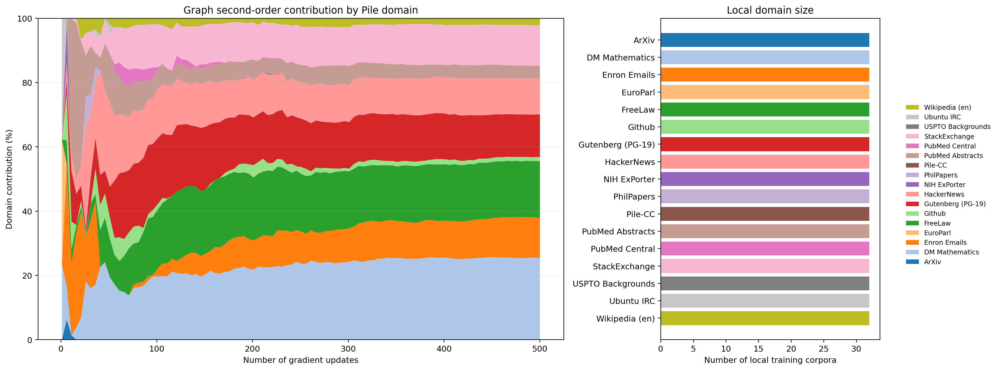
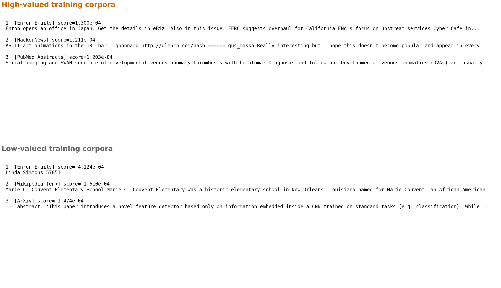

# Figure 3: Graph Domain Dynamics

## Final Domain Composition

| Domain | Final contribution | Raw total |
|---|---:|---:|
| DM Mathematics | 25.423% | +1.313e-03 |
| FreeLaw | 17.624% | +9.103e-04 |
| Gutenberg (PG-19) | 13.298% | +6.869e-04 |
| StackExchange | 12.629% | +6.523e-04 |
| Enron Emails | 12.502% | +6.458e-04 |
| HackerNews | 11.209% | +5.790e-04 |
| PubMed Abstracts | 3.959% | +2.045e-04 |
| Wikipedia (en) | 2.100% | +1.084e-04 |
| Github | 1.256% | +6.490e-05 |
| ArXiv | 0.000% | -2.167e-04 |
| EuroParl | 0.000% | -9.550e-04 |
| NIH ExPorter | 0.000% | -7.094e-05 |
| PhilPapers | 0.000% | -8.593e-04 |
| Pile-CC | 0.000% | -3.373e-04 |
| PubMed Central | 0.000% | -1.276e-04 |
| USPTO Backgrounds | 0.000% | -4.026e-04 |
| Ubuntu IRC | 0.000% | -5.556e-04 |

Domains with negative total value are excluded before positive totals are normalized to 100%.
