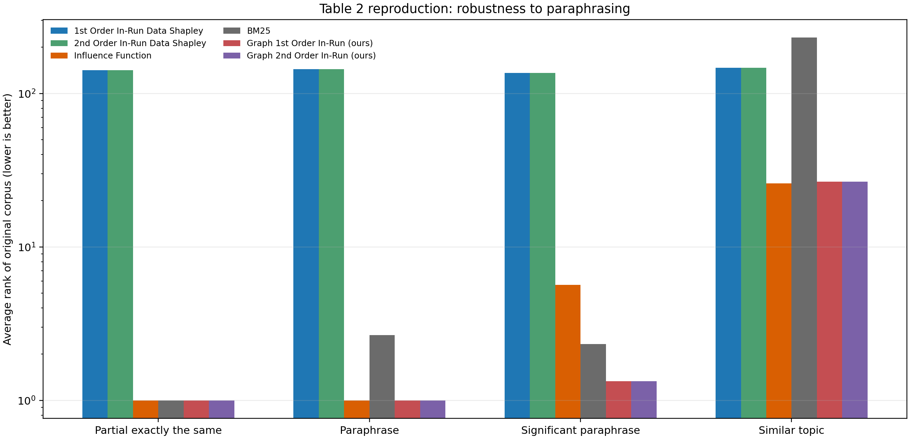

# Table 2 Local Reproduction

Lower average rank is better. Local ranks are among 512 corpora.

```text
Method                         Partial exactly the same  Paraphrase  Significant paraphrase  Similar topic
1st Order In-Run Data Shapley  141.7                     144.0       136.0                   146.7        
2nd Order In-Run Data Shapley  141.7                     144.0       136.0                   146.7        
Influence Function             1.0                       1.0         5.7                     26.0         
BM25                           1.0                       2.7         2.3                     231.3        
Graph 1st Order In-Run (ours)  1.0                       1.0         1.3                     26.7         
Graph 2nd Order In-Run (ours)  1.0                       1.0         1.3                     26.7         
```



## Paper Reference (about 320k corpora)

| Method | Partial exactly the same | Paraphrase | Significant paraphrase | Similar topic |
|---|---:|---:|---:|---:|
| 1st Order In-Run Data Shapley | 1 | 1 | 32.3 | 145.6 |
| 2nd Order In-Run Data Shapley | 1 | 1 | 32 | 141.6 |
| Influence Function | 1 | 1 | 39.3 | 292 |
| BM25 | 1 | 1 | 1.6 | 20917.3 |

Raw ranks across the two corpus sizes are not directly scale-comparable.
